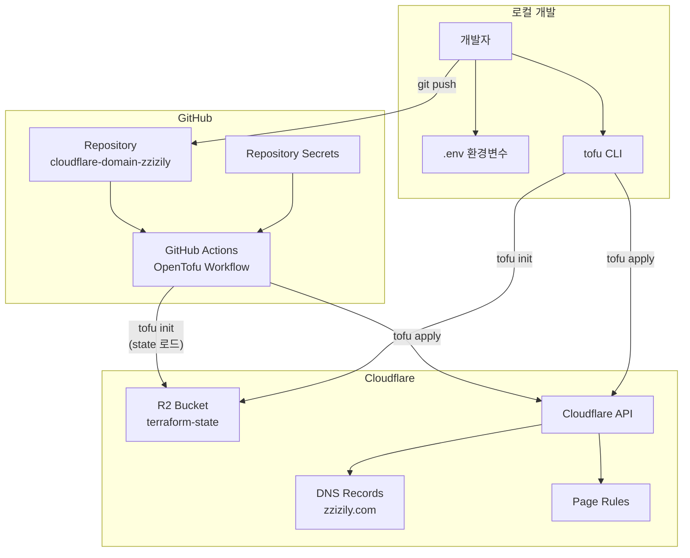
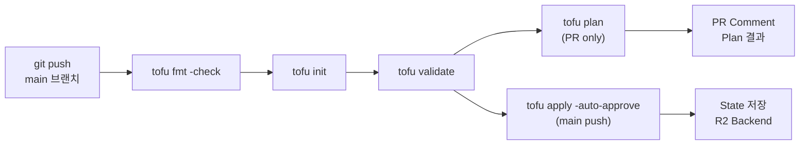
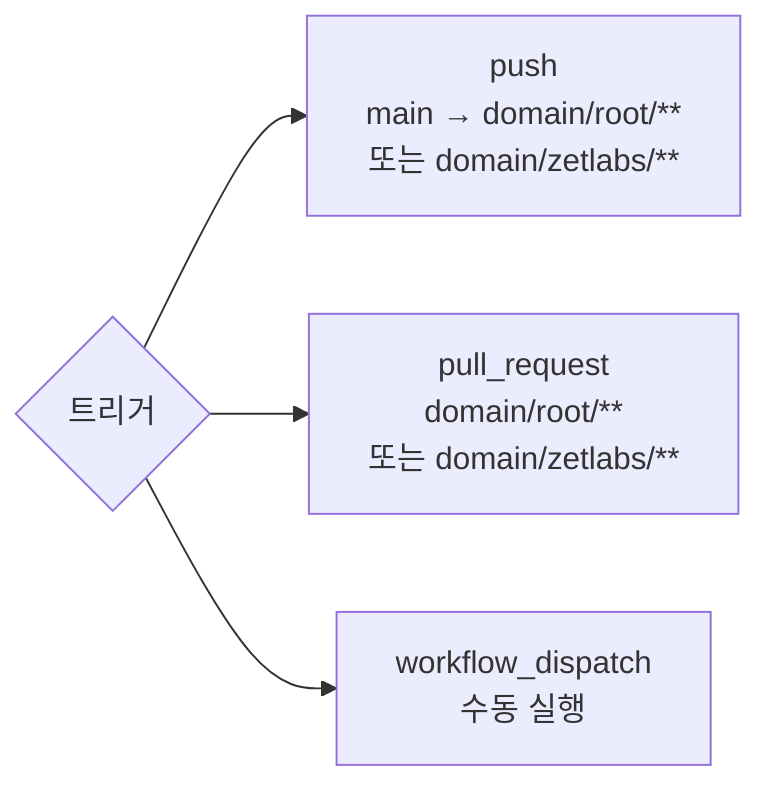

# zzizily.com

[](https://github.com/deuxksy/cloudflare-domain-zzizily/actions/workflows/tofu.yml)

Cloudflare DNS 관리 - OpenTofu + R2 Backend

zzizily.com·zetlabs.net 두 개인 도메인의 Cloudflare DNS를 OpenTofu로 선언적으로 관리한다. 상태는 R2 Backend에 저장하고, GitHub Actions가 PR plan을 검증한 뒤 main merge 시 apply를 자동 실행하는 CI 주도 체계로 운영한다. 로컬에서는 코드 편집과 fmt/validate까지만 수행한다.

## 아키텍처



## CI/CD 파이프라인





## 프로젝트 구조

```
├── .github/workflows/
│   └── tofu.yml              # CI/CD 워크플로우
├── domain/
│   ├── root/                 # zzizily.com
│   │   ├── main.tf           # Backend + Provider + Variables (통합)
│   │   ├── page-rule.tf      # Page Rule (zzizily.com → GitHub 301)
│   │   ├── record-a.tf       # A 레코드 (local, ddns-netgear)
│   │   ├── record-cname.tf   # CNAME 레코드 (tech → GitHub Pages)
│   │   ├── record-ddns.tf    # DDNS 레코드 (Netgear 공유기 — 실제 IP는 repo 미보관, API로 갱신)
│   │   ├── record-google.tf  # Google 서비스 (blog, mail, drive 등)
│   │   ├── record-mail.tf    # MX 레코드 (Google Workspace)
│   │   ├── record-ns.tf      # NS 레코드 (netgear 서브도메인)
│   │   ├── record-openai.tf  # OpenAI 도메인 인증 TXT
│   │   └── record-ssl.tf     # SSL 인증 (ACME challenge)
│   └── zetlabs/              # zetlabs.net
│       ├── main.tf           # Backend + Provider + Variables
│       └── record-mail.tf    # MX, SPF, DKIM, DMARC, Google 인증 (Google Workspace)
├── .env.example              # 환경 변수 템플릿
└── docs/                     # 설계 문서
```

## 시작하기

DNS 변경은 CI가 apply한다 — 로컬 apply는 금지 (로컬 `.env`의 Cloudflare 토큰은 placeholder).

```bash
# 1. 변경: domain/<도메인>/ 내 .tf 파일 편집
# 2. 검증 (R2 접근 자격은 .env, plan 이후는 CI Secrets 사용)
source .env && cd domain/<도메인> && tofu init && tofu fmt -check && tofu validate -no-color
# 3. 브랜치 push → PR 생성 → Actions가 plan을 PR 코멘트에 게시
# 4. plan 검증 후 merge하면 main push 트리거로 tofu apply 자동 실행
```

## 환경 변수

| 변수 | 설명 |
|------|------|
| `AWS_ACCESS_KEY_ID` | R2 접근용 Access Key |
| `AWS_SECRET_ACCESS_KEY` | R2 접근용 Secret Key |
| `TF_VAR_cloudflare_api_token` | Cloudflare API Token (로컬은 placeholder — 실제 apply는 CI Secrets) |
| `TF_VAR_cloudflare_zone_id` | Cloudflare Zone ID |
| `TF_VAR_cloudflare_domain` | 도메인 (zzizily.com) |

## GitHub Secrets

| Secret | 설명 |
|--------|------|
| `AWS_ACCESS_KEY_ID` | R2 Backend 접근용 |
| `AWS_SECRET_ACCESS_KEY` | R2 Backend 접근용 |
| `CLOUDFLARE_API_TOKEN` | Cloudflare API Token |
| `CLOUDFLARE_ZONE_ID` | Cloudflare Zone ID (zzizily.com) |
| `CLOUDFLARE_ZONE_ID_ZETLABS` | Cloudflare Zone ID (zetlabs.net) |
| `CLOUDFLARE_DOMAIN` | 도메인 |
| `CLOUDFLARE_ACCOUNT_ID` | Cloudflare Account ID |
