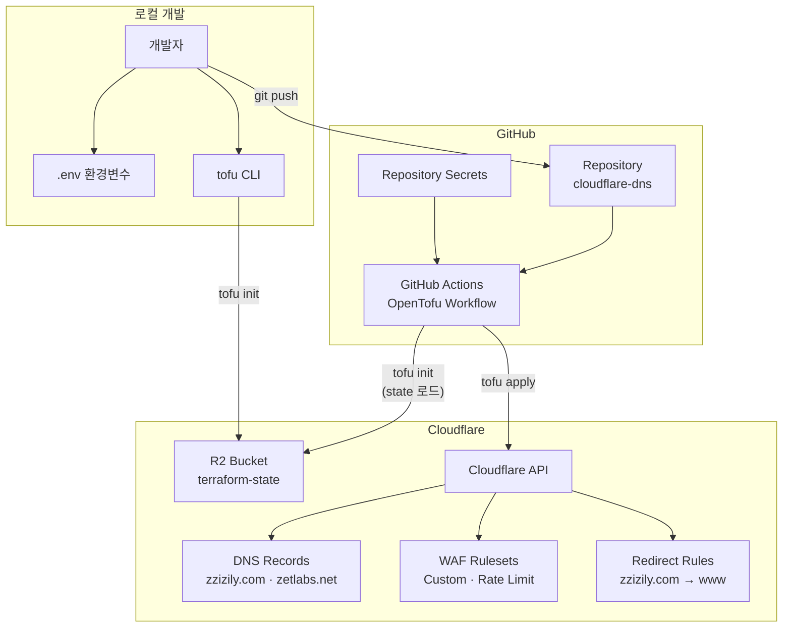
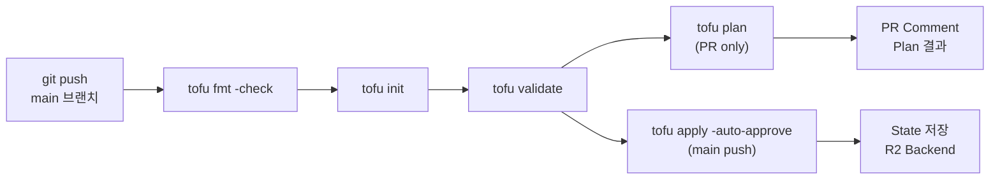
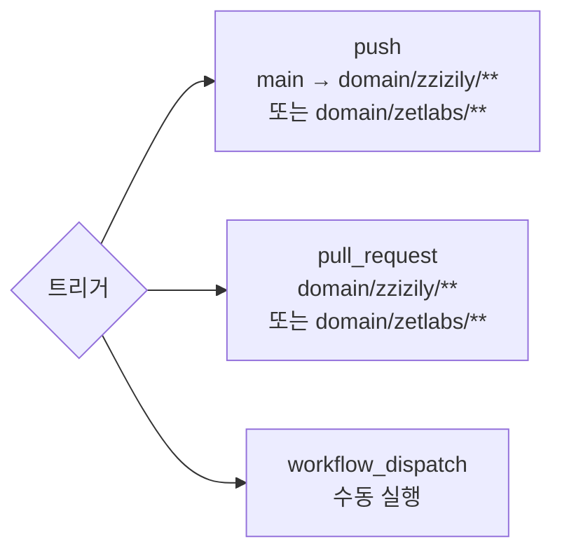

# cloudflare-dns

[](https://github.com/deuxksy/cloudflare-dns/actions/workflows/tofu.yml)

Cloudflare DNS · WAF · Redirect 관리 - OpenTofu + R2 Backend

`zzizily.com`·`zetlabs.net` 두 개인 도메인의 Cloudflare DNS, Free 호환 WAF(Custom Rules · Rate Limiting), Redirect Rule을 OpenTofu와 R2 Backend로 선언적 관리하는 IaC 저장소입니다. GitHub Actions가 PR에서 `tofu plan`을 검증하고 `main` 병합 시 자동 `apply`하는 CI 주도 체계로 운영하며, 로컬에서는 코드 편집과 `fmt`/`validate`/`plan` 검증을 수행합니다.

## 문서 안내 (Diátaxis)

- **Tutorials (시작하기)**: [빠른 시작](#시작하기) - 로컬 검증부터 PR 기반 CI 배포까지의 기본 흐름
- **How-To Guides (작업 절차)**: [CI/CD 파이프라인](#cicd-파이프라인) - PR plan 검증, merge 자동 apply 및 수동 재실행 절차
- **Reference (참고자료)**:
  - [프로젝트 구조](#프로젝트-구조) - 도메인별 OpenTofu 파일 구성
  - [환경 변수](#환경-변수) · [GitHub Secrets](#github-secrets) - R2 Backend 및 Cloudflare Account API Token 설정
  - [문서 허브](./docs/README.md) - `docs/` 하위 디렉터리 안내
- **Explanation (구조 이해)**: [아키텍처](#아키텍처) - 로컬 · GitHub Actions · Cloudflare R2/API 연동 구조

## 아키텍처



## CI/CD 파이프라인





## 프로젝트 구조

```
├── .github/workflows/
│   └── tofu.yml              # CI/CD 워크플로우
├── domain/
│   ├── zzizily/              # zzizily.com
│   │   ├── main.tf           # Backend + Provider + Variables (통합)
│   │   ├── page-rule.tf      # Redirect Rule (zzizily.com → www.zzizily.com 301)
│   │   ├── record-a.tf       # A 레코드 (local, apex)
│   │   ├── record-cname.tf   # CNAME 레코드 (tech, ariadm → GitHub Pages)
│   │   ├── record-existing.tf # 기존 관리 대상 DNS 레코드 (import)
│   │   ├── record-google.tf  # Google/GitHub Pages 관련 레코드 (blog, www, DKIM 등)
│   │   ├── record-mail.tf    # MX 레코드 (Google Workspace)
│   │   ├── record-openai.tf  # OpenAI 도메인 인증 TXT
│   │   ├── record-ssl.tf     # SSL 인증 (ACME challenge)
│   │   └── waf.tf            # Free 호환 WAF (Custom Rules + Rate Limiting)
│   └── zetlabs/              # zetlabs.net
│       ├── main.tf           # Backend + Provider + Variables
│       ├── record-cname.tf   # CNAME 레코드 (@, www → Cloudflare Pages)
│       ├── record-mail.tf    # MX, SPF, DKIM, DMARC, Google 인증 (Google Workspace)
│       └── waf.tf            # Free 호환 WAF (Custom Rules + Rate Limiting)
├── .env.example              # 환경 변수 템플릿
└── docs/                     # 문서 허브 및 내부 설계 문서
```

## 시작하기

인프라 변경(DNS · WAF · Redirect)은 CI가 apply합니다 — 로컬 `tofu apply`는 금지합니다.

```bash
# 1. 변경: domain/<도메인>/ 내 .tf 파일 편집
# 2. 로컬 검증 (.env에 R2 키 및 검증용 API 토큰 설정)
source .env && cd domain/<도메인> && tofu init && tofu fmt -check && tofu validate -no-color && tofu plan -no-color
# 3. 브랜치 push → PR 생성 → Actions가 plan을 PR 코멘트에 게시
# 4. plan 검증 후 merge하면 main push 트리거로 tofu apply 자동 실행
```

## 환경 변수

| 변수 | 설명 |
|------|------|
| `AWS_ACCESS_KEY_ID` | R2 접근용 Access Key |
| `AWS_SECRET_ACCESS_KEY` | R2 접근용 Secret Key |
| `TF_VAR_cloudflare_api_token` | Cloudflare Account API Token (로컬 plan 검증용 — 실제 apply는 CI Secrets) |

## GitHub Secrets

| Secret | 설명 |
|--------|------|
| `AWS_ACCESS_KEY_ID` | R2 Backend 접근용 (R2 Account API Token) |
| `AWS_SECRET_ACCESS_KEY` | R2 Backend 접근용 (R2 Account API Token) |
| `CLOUDFLARE_API_TOKEN` | Cloudflare Account API Token (`DNS`, `Zone WAF Rules`, `Dynamic URL Redirects` Edit) |
