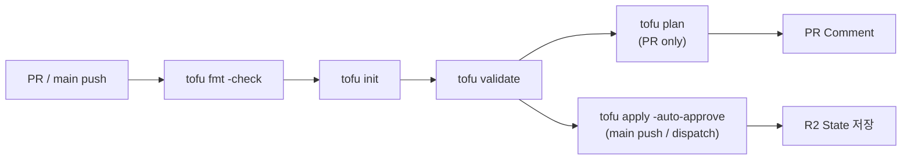

# CI/CD 파이프라인

`.github/workflows/tofu.yml`이 matrix(`zzizily.com`, `zetlabs.net`)로 두 도메인을 병렬 실행합니다.

- **트리거**: `domain/zzizily/**`, `domain/zetlabs/**` 경로의 PR / `main` push, 또는 `workflow_dispatch` 수동 실행
- **동시성 제어**: `main` push apply는 state 손상 방지를 위해 취소하지 않음 (`cancel-in-progress`는 PR에만 적용)
